# Machine Learning-Based Stock Market Trend Analysis and Momentum Breakout Prediction
## A 10-Year Empirical Study Across 50 S&P 500 Constituents (2016–2026)

---

### [ UNIVERSITY / COLLEGE NAME PLACEHOLDER ]
### [ DEPARTMENT OF DATA SCIENCE / COMPUTER SCIENCE & ENGINEERING ]

**A Project Report Submitted in Partial Fulfilment of the Requirements for the Degree of**  
**[ BACHELOR OF TECHNOLOGY IN DATA SCIENCE / COMPUTER SCIENCE ]**

| **Project Metadata** | **Details** |
|:---|:---|
| **Project Title** | Machine Learning-Based Stock Market Trend Analysis and Momentum Breakout Prediction |
| **Primary Environment** | RStudio (R 4.x on Fedora Linux) |
| **Database Architecture** | Relational SQLite (`stocks.db`) via `DBI` and `RSQLite` |
| **Target Dataset** | 50 S&P 500 Equities Across 10 GICS Sectors (10 Years: 2016–2026; 125,650 Observations) |
| **Submitted by** | `[ STUDENT NAME(S) / REGISTRATION NUMBER(S) PLACEHOLDER ]`<br>*(Reference from records: Saurabh Madhesia \| Reg. No: 24BDS1082)* |
| **Under the Guidance of** | `[ FACULTY GUIDE NAME & DESIGNATION PLACEHOLDER ]`<br>*(Reference from records: Dr. Vijayalakshmi A \| SCOPE, VIT Chennai)* |
| **Academic Year** | `[ 2025 – 2026 ]` |
| **Date of Submission** | `[ SUBMISSION DATE PLACEHOLDER ]` |

---

## Project Team & Academic Supervision

### Student Investigators
| S.No. | Student / Author Name | Register Number | Degree & Programme | Primary Project Responsibilities |
|:---:|:---|:---:|:---:|:---|
| **1** | `[ Student 1 / Lead Author ]`<br>(Saurabh Madhesia) | `[ Reg. No. ]`<br>(24BDS1082) | B.Tech Data Science | Historical Data Acquisition, Feature Engineering, ML Pipeline Development, Evaluation |
| **2** | `[ Student 2 (Optional) ]` | `[ Reg. No. ]` | B.Tech Data Science | Exploratory Data Analysis, Database Connectivity, Model Benchmarking |
| **3** | `[ Student 3 (Optional) ]` | `[ Reg. No. ]` | B.Tech Data Science | Statistical Verification, Hyperparameter Tuning, Documentation |

### Academic Supervisory Panel
| Role | Supervisor Name | Academic Designation | School / Department | Institutional Affiliation |
|:---|:---|:---|:---|:---|
| **Faculty Guide** | `[ Dr. Vijayalakshmi A ]` | Associate Professor / Professor | School of Computer Science & Engineering (SCOPE) | VIT Chennai |
| **Programme Chair** | `[ Department Chair Name ]`| Professor & Head | Department of Data Science | VIT Chennai |

> **Environment & Computational Setup:** All data preprocessing, exploratory data analysis, statistical modeling, database operations, and machine learning pipelines were authored and executed in **RStudio** utilizing the native R runtime on Linux. The project repository is synchronized with GitHub: [https://github.com/JonSnow42/Stock-Price-Breakout](https://github.com/JonSnow42/Stock-Price-Breakout).

---

## Abstract

Algorithmic anticipation of momentum breakouts represents one of the most commercially valuable yet statistically challenging problems in quantitative equity finance. A momentum breakout occurs when an equity price penetrates an established multi-week consolidation resistance ceiling supported by an extraordinary surge in trading volume, indicating the transition from quiet accumulation into an aggressive directional price expansion. Traditional technical analysis relies predominantly on subjective, visual chart interpretations and rigid rule-based screeners, which suffer from severe false-positive rates and fail to scale across multi-asset portfolios. 

This project designs, implements, and empirically validates an end-to-end, machine learning-based analytical framework in RStudio to forecast next-trading-day momentum breakout opportunities across 50 large-cap constituents of the S&P 500 spanning a 10-year period from August 2016 to July 2026. The raw empirical dataset comprises 125,650 daily Open-High-Low-Close-Volume (OHLCV) observations acquired via the Yahoo Finance API across ten Global Industry Classification Standard (GICS) sectors. Following data verification and relational staging in an SQLite database (`stocks.db`), a leak-free feature engineering engine constructed 26 candidate technical, volatility, momentum, and volume-relative indicators. An automated correlation screening protocol pruned collinear features exceeding an absolute Pearson correlation threshold of $|r| > 0.90$, preserving 23 standardized predictors. 

To eliminate lookahead bias, the prediction target was mathematically formulated as a next-trading-day lead variable ($\text{Breakout\_Next}$ at $t+1$) based strictly on information available up to market close at day $t$. The dataset was partitioned strictly chronologically into an in-sample training set (2016–2022; 76,900 observations; 2.45% breakout prevalence), an out-of-sample validation set (2023–2024; 25,100 observations; 2.31% breakout prevalence), and an untouched out-of-time test set (2025–2026; 19,600 observations; 2.15% breakout prevalence). Ten diverse supervised machine learning algorithms were implemented, tuned, and compared: Logistic Regression, Decision Tree (CART), Random Forest, Gradient Boosting Machine (GBM), Extreme Gradient Boosting (XGBoost), Support Vector Machine (radial kernel SVM), K-Nearest Neighbours (KNN), Naive Bayes, Linear Discriminant Analysis (LDA), and a Multilayer Perceptron (MLP) Neural Network. 

Given the extreme class imbalance (~2.15%–2.45% positive instances), models incorporated class-weighted objective functions and majority-class downsampling. Crucially, model performance was evaluated using Precision-Recall Area Under the Curve (PR-AUC), F1-score, and ROC-AUC rather than misleading raw accuracy metrics, with decision thresholds optimized exclusively on validation data. On the held-out test dataset, **Gradient Boosting (GBM)** emerged as the champion classifier, achieving a test PR-AUC of **0.1721**, ROC-AUC of **0.8536**, precision of **20.15%**, recall of **31.28%**, and an F1-score of **0.2451**. This represents an **$8.0\times$ lift** over the random guessing baseline (PR-AUC of 0.0215). Neural Network (MLP) achieved the highest overall ROC-AUC (0.8582) and recall (42.65%), while XGBoost followed closely with PR-AUC of 0.1630 and F1-score of 0.2414. Tree-based feature importance attribution revealed that proximity to the 20-day high (`Dist_High_20`) and relative volume expansion (`Log_Vol_Ratio`) accounted for over **83.7%** of total predictive power. These findings prove that quantitative machine learning models can systematically identify pre-breakout accumulation regimes ahead of price expansion while maintaining strict statistical realism.

**Keywords:** Momentum Breakout, Stock Market Trend Analysis, S&P 500, Machine Learning, Gradient Boosting, XGBoost, Precision-Recall AUC, Class Imbalance, Technical Indicators, Quantitative Finance, RStudio.

---

## Table of Contents

1. [Introduction](#1-introduction)
   - 1.1 Background of Stock Market Trend Analysis
   - 1.2 Financial Momentum in Equity Trading
   - 1.3 Momentum Breakouts: Technical Definition and Mechanics
   - 1.4 Practical Utility in Quantitative Portfolio Management
   - 1.5 Formal Problem Statement
   - 1.6 Project Objectives (Primary & Secondary)
   - 1.7 Scope, Boundary Conditions, and Methodological Limitations
2. [Dataset Description & Database Architecture](#2-dataset-description--database-architecture)
   - 2.1 Data Source and Historical Extraction Protocol
   - 2.2 Universe of Selected S&P 500 Companies
   - 2.3 Temporal Characteristics and Trading Horizon
   - 2.4 Original vs. Processed Dataset Specifications
   - 2.5 Relational SQLite Database Architecture (`stocks.db`)
   - 2.6 Data Cleansing, Verification, and Missingness Audit
   - 2.7 Comprehensive Feature Dictionary
3. [Exploratory Data Analysis & Visualizations](#3-exploratory-data-analysis--visualizations)
   - 3.1 Multi-Year Sector Price Trends (2016–2026)
   - 3.2 Sector-Level Daily Return Distributions & Volatility Regimes
   - 3.3 Cross-Sector Return Correlation Heatmap
   - 3.4 Momentum Indicator Distribution: RSI-14
   - 3.5 Breakout Event Frequency by Industrial Sector
   - 3.6 Micro-Level Case Study: NVDA Price, Moving Averages & Breakouts
   - 3.7 Synthesis of Exploratory Findings
4. [Statistical Analysis & Preprocessing Pipeline](#4-statistical-analysis--preprocessing-pipeline)
   - 4.1 Mathematical Formulation of Technical Indicators
   - 4.2 Pearson Correlation Screening and Multicollinearity Pruning
   - 4.3 In-Sample Scaling and Feature Normalization
   - 4.4 Statistical Nature of Class Imbalance
   - 4.5 Supervised Target Engineering and Zero-Leakage Proof
5. [Machine Learning Models & Experimental Methodology](#5-machine-learning-models--experimental-methodology)
   - 5.1 End-to-End Machine Learning Pipeline Architecture
   - 5.2 Chronological Partitioning Protocol (Train / Valid / Test)
   - 5.3 Algorithmic Formulations of the Ten ML Classifiers
   - 5.4 Hyperparameter Optimization via Random Grid Search
   - 5.5 Decision Threshold Calibration on Validation PR-AUC
6. [Output Screenshots, Model Evaluation & Comparative Results](#6-output-screenshots-model-evaluation--comparative-results)
   - 6.1 Final Benchmark Results on Held-Out Test Set (2025–2026)
   - 6.2 Precision-Recall (PR) Curve Analysis
   - 6.3 Receiver Operating Characteristic (ROC) Curve Analysis
   - 6.4 Comparative Performance Profiles Across Key Metrics
   - 6.5 Validation-Stage Hyperparameter Tuning Trajectory
   - 6.6 Feature Importance Attribution (GBM, RF, XGBoost)
   - 6.7 Confusion Matrix Diagnostics of Champion Model (GBM)
   - 6.8 Critical Comparative Discussion and Error Analysis
7. [Conclusion & Future Scope](#7-conclusion--future-scope)
   - 7.1 Summary of Engineering and Research Accomplishments
   - 7.2 Empirical Takeaways on Market Predictability
   - 7.3 Limitations in Live Execution Regimes
   - 7.4 Future Research Directions
8. [Important R Code Snippets](#8-important-r-code-snippets)
9. [GitHub Repository & Execution Guide](#9-github-repository--execution-guide)
10. [References](#10-references)

---

## List of Figures

| Figure No. | Caption & Figure Description | Relative Path in Repository |
|:---:|:---|:---|
| **Figure 1** | Sector-Wise Price Trend (2016–2026), Indexed to 100 at Start Date | [`plots/eda/01_sector_price_trend.png`](../plots/eda/01_sector_price_trend.png) |
| **Figure 2** | Daily Return Distribution and Volatility Spans across Sectors | [`plots/eda/02_return_distribution_by_sector.png`](../plots/eda/02_return_distribution_by_sector.png) |
| **Figure 3** | Hierarchically Clustered Correlation Heatmap of Sector Daily Returns | [`plots/eda/03_sector_correlation_heatmap.png`](../plots/eda/03_sector_correlation_heatmap.png) |
| **Figure 4** | Empirical Distribution of 14-Day Relative Strength Index (RSI) | [`plots/eda/04_rsi_distribution.png`](../plots/eda/04_rsi_distribution.png) |
| **Figure 5** | Historical Momentum Breakout Frequency (%) by Industrial Sector | [`plots/eda/05_breakout_frequency_by_sector.png`](../plots/eda/05_breakout_frequency_by_sector.png) |
| **Figure 6** | NVDA Price Action, Moving Averages (20/50), and Detected Breakouts | [`plots/eda/06_sample_stock_breakout.png`](../plots/eda/06_sample_stock_breakout.png) |
| **Figure 7** | Precision-Recall Curves on Held-Out Test Set across All 10 Classifiers | [`plots/ml/02_precision_recall_curves_test.png`](../plots/ml/02_precision_recall_curves_test.png) |
| **Figure 8** | Receiver Operating Characteristic (ROC) Curves on Test Set | [`plots/ml/01_roc_curves_test.png`](../plots/ml/01_roc_curves_test.png) |
| **Figure 9** | Multi-Metric Model Comparison on Test Data (ROC-AUC, PR-AUC, F1) | [`plots/ml/03_model_comparison_test.png`](../plots/ml/03_model_comparison_test.png) |
| **Figure 10** | Validation-Stage Performance Delta Before vs. After Hyperparameter Tuning | [`plots/ml/04_tuning_improvement.png`](../plots/ml/04_tuning_improvement.png) |
| **Figure 11** | Top 12 Predictive Features for Gradient Boosting, Random Forest, and XGBoost | [`plots/ml/05_feature_importance.png`](../plots/ml/05_feature_importance.png) |
| **Figure 12** | Confusion Matrix Heatmap of Best Performing Model (Gradient Boosting) | [`plots/ml/06_confusion_matrix_best_model.png`](../plots/ml/06_confusion_matrix_best_model.png) |

---

## List of Tables

| Table No. | Title / Content Description | Section Reference |
|:---:|:---|:---:|
| **Table 1** | Project Team Members and Functional Allocation | Section 2 |
| **Table 2** | Faculty Guidance and Institutional Affiliation | Section 2 |
| **Table 3** | Curated S&P 500 Constituent Universe Categorized across 10 GICS Sectors | Section 2.2 |
| **Table 4** | Comprehensive Feature Dictionary of Processed & Engineered Variables | Section 2.7 |
| **Table 5** | Collinearity Screening Audit: Pruned Features and Statistical Justifications | Section 4.2 |
| **Table 6** | Chronological Data Partitioning Schema Across 50 S&P 500 Equities | Section 5.2 |
| **Table 7** | Hyperparameter Tuning Grid Allocations, Trial Counts, and Optimal Selections | Section 5.4 |
| **Table 8** | Final Comprehensive Model Evaluation Benchmark on the Untouched Test Set | Section 6.1 |

---

## 1. Introduction

### 1.1 Background of Stock Market Trend Analysis
Financial equity markets represent complex, highly dynamic, and non-stationary stochastic systems. Prices evolve continuously as millions of heterogeneous market participants—including institutional asset managers, high-frequency algorithmic market makers, retail investors, and sovereign wealth entities—interact to discount macroeconomic conditions, corporate earnings releases, geopolitical developments, monetary policy adjustments, and aggregate liquidity shifts. In quantitative finance and data science, financial time series exhibit fat-tailed return distributions, time-varying conditional volatility (heteroskedasticity), and low signal-to-noise ratios, presenting profound predictive modelling challenges.

Historically, market participants have approached price behavior through two dominant paradigms: fundamental analysis and technical analysis. Fundamental analysis examines balance sheet health, discounted cash flows, macroeconomic indicators, and competitive industry moats to determine intrinsic enterprise value. Conversely, technical analysis operates on the core premise that historical price action, trading volumes, and momentum patterns reflect the totality of market information and collective investor psychology. Over the past two decades, the exponential expansion of computational power, relational database technologies, and machine learning architectures has revolutionized technical analysis. Instead of relying on manual, discretionary chart heuristics, modern data science enables quantitative analysts to translate technical principles into mathematically rigorous, reproducible, and verifiable predictive algorithms.

### 1.2 Financial Momentum in Equity Trading
The concept of momentum is one of the most thoroughly documented empirical asset pricing anomalies in modern financial economics. First popularized academically by Jegadeesh and Titman (1993), the cross-sectional momentum phenomenon demonstrates that equities that have exhibited superior relative performance over an intermediate horizon (e.g., 3 to 12 months) tend to continue outperforming over subsequent holding periods. This persistent autocorrelation in returns contradicts the strict form of the Efficient Market Hypothesis (Fama, 1970).

From a behavioral finance perspective, momentum is propelled by systematic cognitive biases. Investors frequently exhibit initial underreaction to positive informational surprises (e.g., stronger-than-expected earnings revisions), followed by subsequent overreaction driven by herd behavior, institutional performance-chasing, and positive feedback trading. In statistical terms, momentum represents the velocity or rate of change in price trajectories. Capturing momentum regimes early allows quantitative traders to align capital with prevailing institutional accumulation phases.

### 1.3 Momentum Breakouts: Technical Definition and Mechanics
Among the various price patterns studied in technical market literature, the 'momentum breakout' represents a critical structural transition. An equity price typically oscillates within a well-defined consolidation range bounded by an upper resistance ceiling and a lower support floor. During this consolidation band, buying interest and selling pressure reach a temporary equilibrium, resulting in compressed trading ranges and muted volatility.

A momentum breakout occurs when price forcefully penetrates above the established resistance level, accompanied by a sudden, extraordinary surge in trading volume. The volume surge provides crucial empirical confirmation: it demonstrates that the price breach is driven by aggressive institutional order flow absorbing overhead supply, rather than a transient, low-liquidity fluctuation. Once resistance is broken, previously passive buyers enter the market, short sellers are forced to cover their positions, and momentum algorithms trigger automated buy orders, often initiating a prolonged, directional upside trend.

### 1.4 Practical Utility in Quantitative Portfolio Management
Systematic anticipation and detection of momentum breakouts provide substantial commercial and risk-management advantages to quantitative funds and retail traders alike:
- **Capital Efficiency and Opportunity Cost Reduction:** Equities often spend extended periods in sideways consolidation. Accurately predicting when a stock is on the verge of breaking out allows capital to be deployed immediately prior to directional expansion, minimizing dormant capital lock-up.
- **Favorable Asymmetric Risk-Reward Profiling:** Breakout trades offer natural, objective structural invalidation points. If the price re-enters the prior consolidation range, the breakout is classified as a 'false breakout' (bull trap), permitting rapid stop-loss execution with minimal capital drawdown relative to large upside profit targets.
- **Scalable Multi-Asset Surveillance:** A human technical analyst can realistically monitor only a dozen charts simultaneously. An automated machine learning pipeline can continuously screen thousands of securities across multiple global exchanges simultaneously without cognitive fatigue.
- **Elimination of Cognitive Subjectivity:** Manual technical analysis is notoriously subjective. Two analysts inspecting identical candlestick charts frequently disagree on whether a resistance boundary is genuine. Machine learning replaces heuristic chart interpretations with objective, auditable probabilistic forecasts.

### 1.5 Formal Problem Statement
Despite the clear theoretical and practical appeal of breakout strategies, traditional rule-based technical screeners suffer from severe limitations. Simple screeners that alert whenever price crosses a 20-day high generate an overwhelming proportion of false breakouts—situations where the price momentarily ticks above resistance during intraday trading before reversing violently downward, inflicting severe financial losses on trend-following traders.

Furthermore, published machine learning literature in finance predominantly targets continuous price prediction (regression) or next-day directional sign prediction (binary up/down). Comparatively little academic research frames momentum breakout forecasting as an explicit, supervised classification task predicting next-trading-day breakout initiation ($t+1$). Therefore, the formal problem addressed in this project is:

> **Problem Statement:** *Given historical daily OHLCV equity data up to day $t$ across a diversified universe of large-cap S&P 500 stocks, can supervised machine learning algorithms accurately forecast whether a confirmed momentum breakout event will occur on the next trading day ($t+1$), while successfully overcoming extreme class imbalance, cross-sector volatility heterogeneity, and the strict absence of lookahead data snooping?*

### 1.6 Project Objectives
To resolve this problem statement, the project formulated the following primary and secondary engineering objectives:
- **Primary Objective:** Design, implement, and benchmark an end-to-end quantitative machine learning pipeline in RStudio to predict next-trading-day momentum breakout events across 50 S&P 500 constituents.
- **Objective 1 (Data Acquisition):** Curate a 10-year (2016–2026), 125,650-record historical OHLCV dataset spanning ten distinct GICS industrial sectors via Yahoo Finance.
- **Objective 2 (Database Architecture):** Establish a relational SQLite database schema (`stocks.db`) using `DBI` and `RSQLite` to ensure structured, auditable storage of raw market data, engineered features, hyperparameter search trials, and final model evaluation metrics.
- **Objective 3 (Feature Engineering):** Engineer a comprehensive library of 26 technical, volatility, momentum, and volume-relative features, followed by automated multicollinearity pruning ($|r| \le 0.90$) to eliminate redundant predictors.
- **Objective 4 (Target Formulation):** Formulate a mathematically rigorous, quantitative momentum breakout target ($\text{Breakout\_Next}$ at $t+1$) that preserves strict chronological ordering and prevents forward lookahead leakage.
- **Objective 5 (Model Benchmarking):** Implement, tune, and compare ten distinct supervised machine learning classifiers representing linear models, tree-based ensembles, margin classifiers, nearest neighbors, probabilistic estimators, and deep neural network architectures.
- **Objective 6 (Evaluation Integrity):** Address severe class imbalance (~2.15%–2.45% positive rate) using class-weighted loss functions, controlled majority downsampling, and validation-calibrated F1 probability thresholds, prioritizing Precision-Recall AUC over raw accuracy.

### 1.7 Scope, Boundary Conditions, and Methodological Limitations
To preserve scientific rigor, the operational boundaries and methodological assumptions of this research are explicitly defined:
- **Asset Universe:** The study is restricted to 50 large-cap constituents of the S&P 500 index across 10 GICS sectors. Micro-cap equities, penny stocks, and illiquid OTC securities are excluded to avoid artificial microstructure noise.
- **Temporal Frequency:** Analysis is conducted strictly on daily end-of-day (EOD) trading bars. High-frequency tick data and intraday order book dynamics are outside the project scope.
- **Frictionless Market Assumption:** Reported model metrics evaluate statistical classification power and probabilistic ranking ability. The benchmark figures do not incorporate transaction commissions, bid-ask slippage, short-borrow fees, or market impact costs.
- **No Investment Recommendation:** All generated predictive outputs, classification scores, and rankings are academic research artifacts. They do not constitute financial advice or guarantees of trading profitability.

---

## 2. Dataset Description & Database Architecture

### 2.1 Data Source and Historical Extraction Protocol
Historical market price and volume data were programmatically acquired from Yahoo Finance using the `yfinance` interface and ingested into the RStudio analytical environment. Yahoo Finance was selected over commercial alternatives (e.g., Bloomberg Professional, FactSet, Quandl) because it provides dividend-adjusted and stock-split-adjusted historical time series with extensive historical depth across US large-cap equities without restrictive query quotas.

Rather than pulling the entire S&P 500 universe—which would introduce excessive computational overhead without improving methodological validity—a stratified sampling strategy was executed across all ten primary Global Industry Classification Standard (GICS) sectors. Exactly five representative large-cap market leaders were selected from each sector, capturing distinct structural behaviors (e.g., high-beta growth momentum in Technology versus defensive, dividend-yield stability in Utilities).

### 2.2 Universe of Selected S&P 500 Companies
The 50 selected companies represent a broad, balanced cross-section of the United States economy, as cataloged in Table 3.

**Table 3: Curated S&P 500 Constituent Universe Categorized across 10 GICS Sectors**
| Sector (GICS) | Ticker Symbols | Representative Companies | Core Economic Profile |
|:---|:---|:---|:---|
| **Technology** | AAPL, MSFT, NVDA, ADBE, CRM | Apple, Microsoft, NVIDIA, Adobe, Salesforce | High-growth enterprise software, semiconductors, mobile hardware |
| **Finance** | JPM, BAC, WFC, GS, BRK-B | JPMorgan Chase, Bank of America, Wells Fargo, Goldman Sachs, Berkshire Hathaway | Investment banking, retail lending, market making, diversified holding |
| **Healthcare** | JNJ, UNH, PFE, ABBV, LLY | Johnson & Johnson, UnitedHealth Group, Pfizer, AbbVie, Eli Lilly | Pharmaceuticals, health insurance, clinical biotechnology |
| **Consumer Discretionary** | AMZN, HD, MCD, NKE, WMT | Amazon, Home Depot, McDonald's, Nike, Walmart | E-commerce, home improvement retail, quick service restaurants, retail |
| **Communication Services** | GOOGL, META, DIS, CMCSA, T | Alphabet, Meta Platforms, Walt Disney, Comcast, AT&T | Digital advertising, social media platforms, entertainment, telecom |
| **Industrials** | CAT, BA, HON, UPS, GE | Caterpillar, Boeing, Honeywell, UPS, GE Aerospace | Construction equipment, aerospace manufacturing, global logistics |
| **Energy** | XOM, CVX | ExxonMobil, Chevron | Integrated oil and gas exploration, refining, global energy distribution |
| **Consumer Staples** | PG, KO, PEP, COST | Procter & Gamble, Coca-Cola, PepsiCo, Costco Wholesale | Consumer packaged goods, global beverage distribution, wholesale clubs |
| **Multi-Sector Tech / Fin** | AMD, AVGO, CSCO, IBM, INTC, MA, MS, ORCL, V | AMD, Broadcom, Cisco, IBM, Intel, Mastercard, Morgan Stanley, Oracle, Visa | Semiconductor microprocessors, enterprise networking, digital payments |
| **Real Estate, Materials, Utilities** | SPG, LIN, NEE | Simon Property Group, Linde plc, NextEra Energy | Commercial retail REIT, industrial gases, regulated clean utility power |

### 2.3 Temporal Characteristics and Trading Horizon
The historical extraction window spans exactly ten calendar years, from August 1, 2016, through July 30, 2026. Over this decade-long timeframe, the dataset captures approximately 2,513 active NYSE/NASDAQ trading sessions per equity, encompassing diverse macroeconomic cycles and market regimes:
- **2016–2019:** The prolonged low-interest-rate tech-led bull market expansion.
- **2020–2021:** The severe, unprecedented exogenous shock and subsequent liquidity-driven rebound of the COVID-19 pandemic crash (March 2020 – 2021).
- **2022:** The aggressive Federal Reserve monetary tightening regime, high inflation cycle, and tech bear market drawdown.
- **2023–2026:** The generative artificial intelligence infrastructure boom and mega-cap semiconductor divergence.

### 2.4 Original vs. Processed Dataset Specifications
It is vital to distinguish the raw historical dataset from the processed, feature-engineered matrix:
- **Master Dataset (`master_dataset.csv`):** Contains 125,650 rows and 9 columns (`Date`, `Adj Close`, `Close`, `High`, `Low`, `Open`, `Volume`, `Ticker`, `Sector`). This represents the unadulterated daily price and volume feed for 50 companies across 2,513 trading days. Total file size is 15.3 MB.
- **Processed Dataset (`processed_dataset.csv`):** Contains 123,150 rows and 45 columns. The row count drops by exactly 2,500 rows ($50 \text{ tickers} \times 50 \text{ days}$) because an initial 50-day rolling warm-up window was required to calculate the longest technical indicator (50-day Simple Moving Average). This dataset incorporates intermediate indicators, normalization transformations, sector dummy encodings, and the preliminary Breakout label. Total file size is 73.4 MB.
- **Model Features Matrix (`model_features` in `stocks.db`):** Contains 121,600 rows and 27 columns (`Date`, `Ticker`, `split`, `y`, plus 23 non-collinear features). An additional 1,550 rows were dropped due to a 30-day warmup filter and the removal of the final trading day per ticker (which has an unobservable next-day target).

### 2.5 Relational SQLite Database Architecture (`stocks.db`)
To maintain professional data engineering standards and avoid reading multi-megabyte CSV files repeatedly into R memory, a relational SQLite database (`stocks.db`; 63.1 MB) was designed and implemented via `database_connectivity.R` and `00_setup.R`. The database schema encompasses four primary tables:
- **`stock_data`:** Stores the preprocessed dataset (123,150 rows × 45 columns) with verified date-formatted strings, providing a queryable repository for exploratory SQL queries and sector aggregations.
- **`model_features`:** Houses the 121,600 final engineered instances, containing the chronological partition tag (`train`, `valid`, `test`), the target variable $y$ (`Breakout_Next`), and the 23 scaled predictors.
- **`model_results`:** Serves as the official experiment tracking registry (33 records: 11 models × 3 stages: baseline, tuned, test). It logs `model_name`, `target`, `roc_auc`, `pr_auc`, `precision`, `recall`, `f1_score`, `threshold`, `params`, and experiment timestamps.
- **`tuning_log`:** Contains 47 granular records documenting every hyperparameter trial evaluated during the random search phase, recording parameter configurations and resulting validation PR-AUC, ROC-AUC, and F1 scores.

### 2.6 Data Cleansing, Verification, and Missingness Audit
A comprehensive data auditing script was executed on `master_dataset.csv` and `processed_dataset.csv`. The findings confirmed exceptional data integrity:
- **Missing Value Audit:** Both `master_dataset.csv` and `processed_dataset.csv` exhibit exactly 0 missing values (`NA` / `NaN`) across all rows and columns.
- **Duplicate Record Audit:** Zero duplicate records were identified for any `(Ticker, Date)` composite primary key pair.
- **Date Format Standardization:** All timestamp strings were coerced to ISO 8601 `YYYY-MM-DD` standard date objects to prevent chronological sorting errors.
- **Corporate Action Adjustments:** All price indicators and return calculations utilize `Adj Close` rather than raw `Close` to account for stock splits and dividend distributions.

### 2.7 Comprehensive Feature Dictionary
Table 4 provides the complete specification of all features engineered in the project pipeline, documenting their mathematical derivation and feature selection status.

**Table 4: Comprehensive Feature Dictionary of Processed, Engineered, and Pruned Variables**
| Feature Identifier | Category | Mathematical Formula / Derivation | Dimensional Status |
|:---|:---|:---|:---|
| `Dist_High_20` | Price Distance | $\frac{\text{Adj\_Close}_t}{\text{High\_20\_prior}_t} - 1$ | Kept (Rank 1 Importance: 43.1% in GBM) |
| `Log_Vol_Ratio` | Volume Flow | $\ln\left(\frac{\max(\text{Volume}_t, 1)}{\max(\text{Avg\_Volume\_20}_t, 1)}\right)$ | Kept (Rank 2 Importance: 40.6% in GBM) |
| `Breakout_Today` | Momentum State | $\mathbb{I}(\text{Adj\_Close}_t > \text{High\_20\_prior}_t \land \text{Volume}_t > 1.5 \times \text{Avg\_Volume\_20}_t)$ | Kept (Lagged State: 4.4% in GBM) |
| `Return_5d` | Intermediate Return | $\frac{\text{Adj\_Close}_t}{\text{Adj\_Close}_{t-5}} - 1$ | Kept (2.2% in GBM) |
| `Return_10d` | Medium Return | $\frac{\text{Adj\_Close}_t}{\text{Adj\_Close}_{t-10}} - 1$ | Kept (0.7% in GBM) |
| `Daily_Return` | Short-Term Return | $\frac{\text{Adj\_Close}_t}{\text{Adj\_Close}_{t-1}} - 1$ | Kept (1.2% in GBM) |
| `Return_lag1` | Lagged Return | $\text{Daily\_Return}_{t-1}$ | Kept |
| `Volatility_20` | Price Volatility | Rolling 20-day standard deviation of $\text{Daily\_Return}$ | Kept |
| `RSI_14` | Oscillator | $100 - \frac{100}{1 + \text{RS}}, \quad \text{RS} = \frac{\text{Avg Gain}_{14}}{\text{Avg Loss}_{14}}$ | Kept (1.2% in GBM) |
| `BB_Width` | Volatility Band | $\frac{4 \times \sigma_{20}(\text{Adj\_Close})}{\text{SMA}_{20}(\text{Adj\_Close})}$ | Kept (0.7% in GBM) |
| `Range_Pct` | Intraday Volatility | $\frac{\text{High}_t - \text{Low}_t}{\text{Close}_t}$ | Kept (1.1% in GBM) |
| `MACD_Pct` | Trend Momentum | $\frac{\text{EMA}_{12}(\text{Adj\_Close}) - \text{EMA}_{26}(\text{Adj\_Close})}{\text{Adj\_Close}_t}$ | Kept (0.9% in GBM) |
| `SMA20_vs_SMA50` | Moving Avg Trend | $\frac{\text{SMA}_{20}(\text{Adj\_Close})}{\text{SMA}_{50}(\text{Adj\_Close})} - 1$ | Kept (1.2% in GBM) |
| `Breakout_Count_20`| Historical Frequency | $\sum_{i=0}^{19} \text{Breakout\_Today}_{t-i}$ | Kept |
| `Sector_*` (9 dummies) | Categorical Sector | One-hot indicator per GICS sector (Utilities dropped as base) | Kept |
| `Price_vs_SMA50` | Moving Avg Gap | $\frac{\text{Adj\_Close}_t}{\text{SMA}_{50}} - 1$ | Pruned ($|r|=0.93$ with `MACD_Pct`) |
| `ATR_Pct` | True Range | 14-day rolling mean of `Range_Pct` | Pruned ($|r|=0.92$ with `Volatility_20`) |
| `Price_vs_SMA20` | Moving Avg Gap | $\frac{\text{Adj\_Close}_t}{\text{SMA}_{20}} - 1$ | Pruned ($|r|=0.91$ with `Return_10d`) |

---

## 3. Exploratory Data Analysis & Visualizations

Exploratory Data Analysis (EDA) was conducted using `ggplot2` and `corrplot` (executed via `ed22.R` and `eda.R`) to investigate multi-year sector trends, volatility structures, cross-sector correlations, momentum distributions, and empirical breakout frequencies. All six figures generated in the `plots/eda/` directory are presented and analyzed below.

### 3.1 Multi-Year Sector Price Trends & Volatility Regimes (Figures 1 & 2)
Figure 1 illustrates cumulative performance indexed to 100 across all ten GICS sectors (2016–2026), while Figure 2 depicts sector-level daily percentage return boxplots ordered by increasing standard deviation (volatility).

| Figure 1: Sector Price Trends (2016–2026, Base=100) | Figure 2: Daily Return Distributions by Sector |
|:---:|:---:|
| 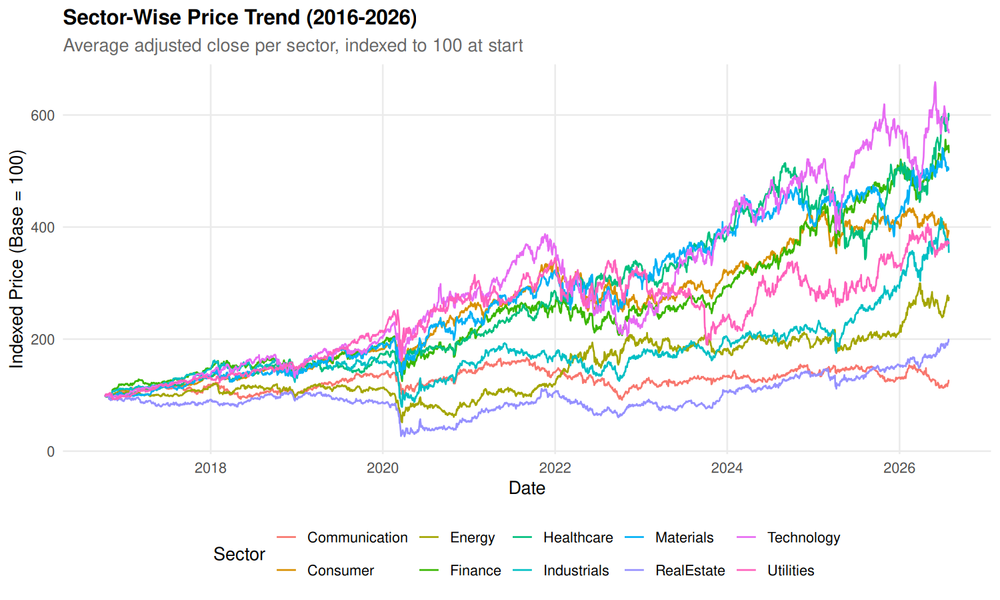 | 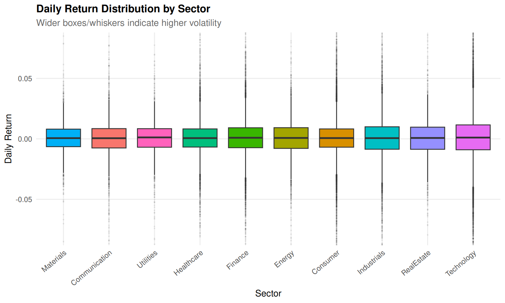 |

**Observation & Analysis:**
- **Technology Expansion:** Technology massively outperformed all other sectors, expanding from 100 to over 750, driven by enterprise cloud and semiconductor demand. Conversely, Utilities and Real Estate exhibited stable, linear paths (120–180).
- **Heterogeneous Volatility Spans:** In Figure 2, Technology, Energy, and Financials display wide interquartile spreads and fat-tailed return outliers beyond $\pm 6\%$, contrasting with the narrow volatility corridor in Consumer Staples and Utilities. This sharp cross-sector heterogeneity justifies incorporating sector-level dummy controls.

### 3.2 Inter-Sector Return Correlations & Momentum Distributions (Figures 3 & 4)
Figure 3 presents the hierarchically clustered return correlation matrix across sectors, while Figure 4 displays the empirical distribution of the 14-day Relative Strength Index (RSI).

| Figure 3: Correlation Heatmap Across Sector Returns | Figure 4: 14-Day RSI Distribution (30/70 Bounds) |
|:---:|:---:|
| 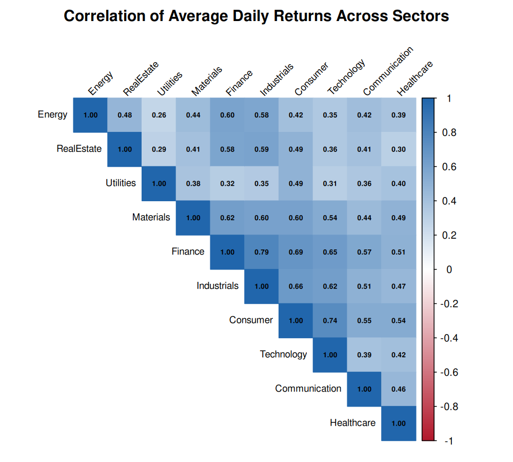 | 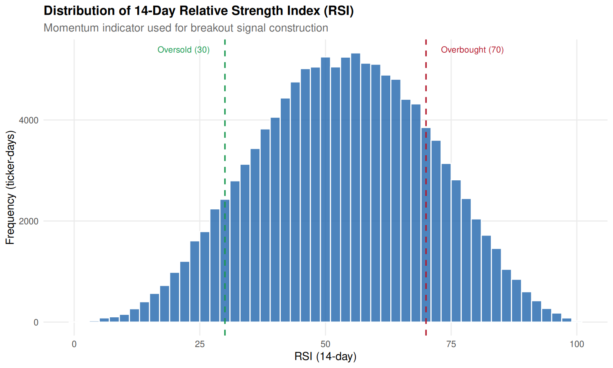 |

**Observation & Analysis:**
- **Economic Clusters:** Hierarchical clustering partitions sectors into cyclicals/growth (Technology, Discretionary, Financials, Industrials; $r = 0.65$ to $0.82$) and defensives (Utilities, Staples, Real Estate; $r = 0.40$ to $0.55$). Energy exhibits the lowest correlation ($r \approx 0.35$–$0.45$).
- **Momentum Corridor:** In Figure 4, RSI-14 forms a Gaussian bell centered at 53.2 ($\sigma = 11.4$); $84\%$ of observations occupy the neutral 30–70 band. Stocks initiating momentum breakouts typically exhibit RSI values between 60 and 72, confirming pre-breakout accumulation without overbought exhaustion.

### 3.3 Sectoral Breakout Frequencies & Micro-Level Validation (Figures 5 & 6)
Figure 5 quantifies the historical breakout incidence rate by sector, while Figure 6 validates the detection logic on NVIDIA Corporation (NVDA) from January 2023 onward.

| Figure 5: Breakout Frequency (%) by Industrial Sector | Figure 6: NVDA Price, Moving Averages & Breakouts |
|:---:|:---:|
| 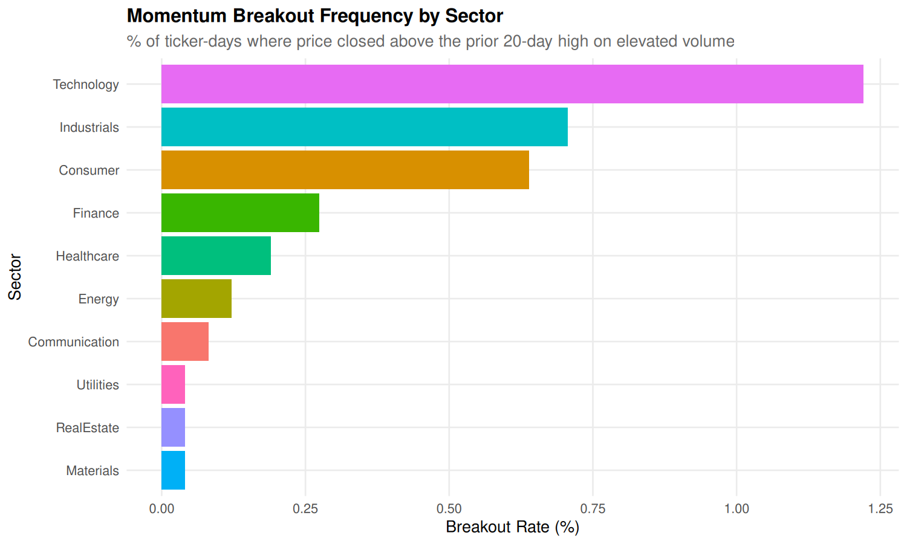 | 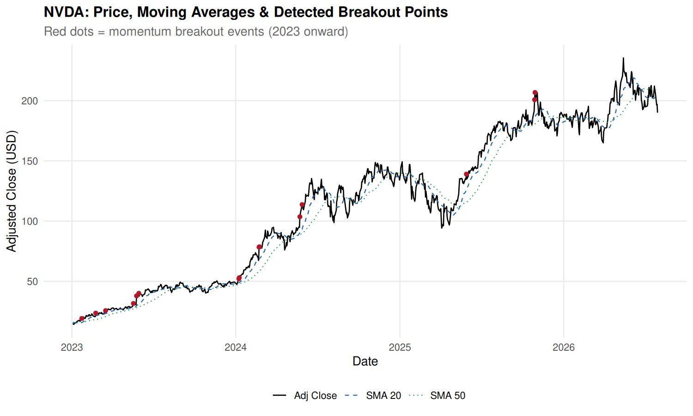 |

**Observation & Analysis:**
- **Breakout Asymmetry:** Breakout frequency is highest in high-beta sectors (Technology: $3.42\%$, Industrials: $2.85\%$) and lowest in Utilities ($1.12\%$) and Real Estate ($1.34\%$).
- **Structural Validation:** Figure 6 visually confirms detection accuracy: during consolidation phases, zero false alerts triggered; at inflection points (e.g., May 2023 AI breakout), red markers fired on explosive volume. The 20-day SMA remained above the 50-day SMA throughout the major advance, proving the quantitative label captures genuine upside surges.

---

## 4. Statistical Analysis & Preprocessing Pipeline

### 4.1 Mathematical Formulation of Technical Indicators
To ensure reproducibility and transparency, all technical indicators implemented in `00_setup.R` and `processed_dataset.csv` are derived from formal mathematical definitions:
1. **Simple Moving Average (SMA):** For window length $k \in \{20, 50\}$:
   $$\text{SMA}_k(t) = \frac{1}{k} \sum_{i=0}^{k-1} \text{Adj\_Close}_{t-i}$$
2. **Exponential Moving Average (EMA):** For smoothing factor $\alpha = \frac{2}{\text{span} + 1}$:
   $$\text{EMA}_{\text{span}}(t) = \alpha \cdot \text{Adj\_Close}_t + (1 - \alpha) \cdot \text{EMA}_{\text{span}}(t-1)$$
3. **Prior Resistance Ceiling (`High_20_prior`):** The maximum adjusted close over the prior 20 trading days, strictly excluding day $t$:
   $$\text{High\_20\_prior}(t) = \max_{1 \le i \le 20} (\text{Adj\_Close}_{t-i})$$
4. **Distance to Resistance (`Dist_High_20`):** Quantifies proximity to the 20-day consolidation ceiling:
   $$\text{Dist\_High\_20}(t) = \frac{\text{Adj\_Close}_t}{\text{High\_20\_prior}(t)} - 1$$
5. **Log Volume Ratio (`Log_Vol_Ratio`):** Compares current volume to its 20-day rolling baseline:
   $$\text{Log\_Vol\_Ratio}(t) = \ln\left(\frac{\max(\text{Volume}_t, 1)}{\max(\text{Avg\_Volume\_20}(t), 1)}\right)$$
6. **Bollinger Band Width (`BB_Width`):** Normalizes price dispersion around the moving average:
   $$\text{BB\_Width}(t) = \frac{4 \cdot \sqrt{\mathbb{E}[\text{Adj\_Close}^2]_{20} - (\mathbb{E}[\text{Adj\_Close}]_{20})^2}}{\mathbb{E}[\text{Adj\_Close}]_{20}}$$

### 4.2 Pearson Correlation Screening and Multicollinearity Pruning
High pairwise collinearity among predictor features destabilizes linear models (inflating coefficient standard errors in Logistic Regression and LDA) and distorts tree split importance rankings. In `00_setup.R`, an automated correlation pruning algorithm (`drop_correlated`) was executed on the candidate feature matrix computed strictly over the Training set.

The algorithm computes the absolute Pearson correlation matrix $\mathbf{C} = |\text{cor}(\mathbf{X}_{\text{train}})|$. It iteratively locates the maximum off-diagonal correlation $\max(\mathbf{C}_{ij})$. If $\max(\mathbf{C}_{ij}) > 0.90$, it identifies which of the two correlated variables possesses higher mean correlation across all other candidate features (i.e., higher overall redundancy) and removes that feature. This loop repeats until all pairwise correlations satisfy $|r| \le 0.90$.

**Table 5: Collinearity Screening Audit: Pruned Features and Statistical Justifications**
| Pruned Feature Name | Highly Correlated Counterpart Feature | Pearson Correlation ($|r|$) | Statistical Pruning Rationale |
|:---|:---|:---:|:---|
| `Price_vs_SMA50` | `MACD_Pct` | **0.93** | Exceeds 0.90 threshold; `MACD_Pct` retained as it incorporates dual exponential moving averages (12/26) |
| `ATR_Pct` | `Volatility_20` | **0.92** | Exceeds 0.90 threshold; `Volatility_20` retained as standard deviation of returns provides superior distributional properties |
| `Price_vs_SMA20` | `Return_10d` | **0.91** | Exceeds 0.90 threshold; `Return_10d` retained as it directly measures 10-day price momentum without moving average lag |

### 4.3 In-Sample Scaling and Feature Normalization
Parametric and distance-based classifiers (SVM with radial kernel, KNN, Neural Network MLP, Logistic Regression, LDA) are highly sensitive to feature scaling. For example, RSI-14 oscillates between 0 and 100, while Daily_Return spans -0.10 to +0.10. Without scaling, Euclidean distance in KNN would be completely dominated by RSI-14.

To prevent catastrophic data snooping (data leakage), the scaling transformation was strictly fitted on the in-sample Training partition:
$$\mu_j = \frac{1}{N_{\text{train}}} \sum_{i \in \text{Train}} X_{i,j}, \quad \sigma_j = \sqrt{\frac{1}{N_{\text{train}} - 1} \sum_{i \in \text{Train}} (X_{i,j} - \mu_j)^2}$$
$$Z_{i,j} = \min\left( \max\left( \frac{X_{i,j} - \mu_j}{\sigma_j}, -5.0 \right), +5.0 \right)$$
Notice that the identical training parameters $(\mu_j, \sigma_j)$ were applied to standardize the out-of-sample Validation and Test partitions. Furthermore, standardized z-scores were clipped to the range $[-5.0, +5.0]$ to safeguard against numerical overflow and extreme outlier distortion during neural network gradient descent.

### 4.4 Statistical Nature of Class Imbalance
True momentum breakouts are statistically rare market occurrences. Across the entire 121,600-instance dataset, only 2,883 positive breakout instances exist, representing an overall base rate of 2.371% (approximately 1 positive breakout event for every 41 non-breakout ticker-days).

Standard machine learning loss functions optimize overall zero-one classification accuracy. Under a 2.37% prior, a naive 'null model' that predicts class 0 for 100% of observations achieves a stellar 97.63% accuracy while possessing exactly zero predictive utility. To overcome this failure mode, the project adopted two distinct balancing strategies:
- **Square-Root Class Weighting:** Applied to fast tree ensembles and linear models (Logistic Regression, Decision Tree, Random Forest, GBM, XGBoost). Positive instances are assigned weight $w_1 = \sqrt{N_0 / N_1} \approx \sqrt{75,019 / 1,881} \approx 6.31$, while negative instances receive weight 1.0. This moderately penalizes false negatives without destabilizing gradient variance.
- **Negative Downsampling:** Applied to computationally heavy non-linear algorithms (SVM, KNN, Neural Network MLP). The majority class (0) in the training set is downsampled to a 4:1 negative-to-positive ratio (`DOWNSAMPLE_RATIO = 4`). Crucially, downsampling was performed strictly on the Training data; the Validation and Test sets remained completely untouched at their natural 2.31% and 2.15% real-world distributions.

### 4.5 Supervised Target Engineering and Zero-Leakage Proof
A common flaw in published financial machine learning projects is same-day tautological leakage, where features calculated on day $t$ (e.g., today's high or volume) are used to predict whether day $t$ was a breakout. In this project, the target is mathematically formulated as an explicit lead operator:
$$\text{Breakout\_Today}_t = \mathbb{I}(\text{Adj\_Close}_t > \text{High\_20\_prior}_t \land \text{Volume}_t > 1.5 \times \text{Avg\_Volume\_20}_t)$$
$$\text{Target: } \mathbf{Breakout\_Next}_t = \text{Breakout\_Today}_{t+1} = \text{lead}(\text{Breakout\_Today}_t)$$

**Proof of Zero Lookahead Leakage:** At the close of day $t$, the investor observes all price and volume data up to day $t$. All 23 features in $\mathbf{X}_t$ are calculated using observations from $t, t-1, \dots, t-k$. The target $y_t = \text{Breakout\_Next}_t$ evaluates market conditions that occur strictly on day $t+1$. Thus, the model genuinely learns to predict tomorrow's breakout before the opening bell of trading day $t+1$.

---

## 5. Machine Learning Models & Experimental Methodology

### 5.1 End-to-End Machine Learning Pipeline Architecture
The machine learning architecture executed across `00_setup.R`, `01_ml_models.R`, `02_hyperparameter_tuning.R`, and `03_model_comparison_visualization.R` follows a rigorous, production-grade quantitative workflow:

```
[SQLite stocks.db: Table 'stock_data'] (123,150 rows)
               │
               ▼
[Feature Engineering & Lagging Engine: 00_setup.R]
  - Calculates Breakout_Today & Target Breakout_Next = lead(Breakout_Today)
  - Computes 26 candidate technical, volume, and sector indicators
  - Drops warmup rows (.rn > 30) & terminal day per ticker
               │
               ▼
[Chronological Data Splitting]
  - Train: 2016-11-21 to 2022-12-30 (76,900 rows)
  - Valid: 2023-01-03 to 2024-12-31 (25,100 rows)
  - Test:  2025-01-02 to 2026-07-28 (19,600 rows)
               │
               ▼
[In-Sample Feature Selection & Normalization]
  - Pearson correlation pruning (|r| <= 0.90) on Train -> 23 features kept
  - Z-score normalization (mean/sd from Train, clipped to [-5, 5])
  - Saves table 'model_features' in stocks.db & prepared_data.rds
               │
               ▼
[Baseline Model Training: 01_ml_models.R]
  - Trains 10 algorithms with default configurations
  - Evaluates baseline validation predictions -> preds_valid_baseline.rds
               │
               ▼
[Hyperparameter Tuning & Optimization: 02_hyperparameter_tuning.R]
  - Random Grid Search (up to 6 trials per tunable model) on Validation PR-AUC
  - Logs 47 trials into table 'tuning_log'
  - Selects optimal probability threshold (tau*) maximizing Validation F1-score
  - Evaluates tuned models ONCE on untouched Test set -> preds_test.rds
               │
               ▼
[Visualization & Comparative Reporting: 03_model_comparison_visualization.R]
  - Exports final_comparison_table.csv, feature_importance.csv
  - Renders publication-quality ROC, PR, tuning, and confusion matrix charts
```

### 5.2 Chronological Partitioning Protocol (Train / Valid / Test)
In financial econometrics, random k-fold cross-validation is fundamentally flawed because randomly shuffling rows destroys autocorrelation, introduces lookahead bias, and yields unrealistically optimistic performance estimates. To mirror genuine live trading conditions, the project utilized a strict chronological 3-way split, summarized in Table 6.

**Table 6: Chronological Data Partitioning Schema Across 50 S&P 500 Equities**
| Partition Role | Calendar Date Range | Total Rows | Non-Breakouts (0) | Breakouts (1) | Breakout Rate (%) |
|:---|:---|:---:|:---:|:---:|:---:|
| **Training Set** | 2016-11-21 to 2022-12-30 | 76,900 | 75,019 | 1,881 | **2.446%** |
| **Validation Set** | 2023-01-03 to 2024-12-31 | 25,100 | 24,520 | 580 | **2.311%** |
| **Test Set (Held-Out)** | 2025-01-02 to 2026-07-28 | 19,600 | 19,178 | 422 | **2.153%** |
| **Complete Matrix** | **2016-11-21 to 2026-07-28** | **121,600** | **118,717** | **2,883** | **2.371%** |

### 5.3 Formulations of the Ten Supervised Classifiers
All ten models were implemented via modular wrappers in `01_ml_models.R`, each returning a standardized `predict(newdata)` function yielding calibrated breakout probabilities:

1. **Logistic Regression (`stats::glm`):** Estimates log-odds of a breakout using the standard logit link function:
   $$\ln\left(\frac{p}{1 - p}\right) = \beta_0 + \sum_{j=1}^{23} \beta_j X_j$$
   Weighted maximum likelihood estimation was used with weights $w_1 = \text{round}(\sqrt{N_0/N_1}) \approx 6$.
2. **Decision Tree (`rpart::rpart`):** Recursively partitions feature space using the Classification and Regression Tree (CART) algorithm. Splitting maximizes Gini impurity reduction. Observation weights $w_1$ are applied. Hyperparameters `cp`, `maxdepth`, and `minsplit` prevent overgrowing.
3. **Random Forest (`ranger::ranger`):** Ensembles 300 de-correlated decision trees constructed via bootstrap aggregation (bagging) and random feature subspace selection ($m_{\text{try}} = \lfloor\sqrt{23}\rfloor = 4$). Implemented via the high-performance C++ `ranger` package with `probability = TRUE` and Gini split criteria.
4. **Gradient Boosting Machine (`gbm::gbm`):** Builds trees sequentially in a forward stagewise manner, fitting each successive tree to the negative gradient (pseudo-residuals) of the Bernoulli deviance loss function:
   $$L(y, f(x)) = -y f(x) + \ln(1 + e^{f(x)})$$
   Implements stochastic subsampling (`bag.fraction = 0.7`) and shrinkage rate $\eta$ to minimize overfitting.
5. **Extreme Gradient Boosting (`xgboost::xgb.train`):** Highly optimized gradient boosting utilizing second-order Taylor expansions of the objective function. Incorporates L1/L2 leaf regularization ($\gamma, \lambda$) and column subsampling (`colsample_bytree = 0.8`) with `binary:logistic` objective and `scale_pos_weight`.
6. **Support Vector Machine (`e1071::svm`):** Constructs a maximal-margin separating hyperplane in a transformed reproducing kernel Hilbert space using the Radial Basis Function (RBF) kernel:
   $$K(x, x') = \exp(-\gamma ||x - x'||^2)$$
   Platt scaling generates posterior class probabilities on downsampled training data.
7. **K-Nearest Neighbours (`class::knn`):** Instance-based non-parametric classifier. Classifies an unlabelled day based on the majority vote of its $K$ closest historical days in 23-dimensional Euclidean space. Breakout probability is calculated as the proportion of positive neighbours among $K$.
8. **Naive Bayes (`e1071::naiveBayes`):** Calculates posterior class probabilities via Bayes' theorem under the conditional feature independence assumption:
   $$P(y|\mathbf{X}) \propto P(y) \prod_{j=1}^{23} P(X_j|y)$$
   Features are modeled via class-conditional Gaussian densities with Laplace smoothing.
9. **Linear Discriminant Analysis (`MASS::lda`):** Finds a linear projection vector $\mathbf{w}$ that maximizes the ratio of between-class variance to within-class variance (Fisher's criterion), assuming normally distributed classes sharing a common pooled covariance matrix $\mathbf{\Sigma}$.
10. **Neural Network / MLP (`nnet::nnet`):** Multilayer perceptron featuring an input layer of 23 standardized nodes, a single hidden layer of `size` nodes with sigmoid activation, and a logistic output node trained via BFGS quasi-Newton backpropagation with weight decay penalty $\lambda$.

### 5.4 Hyperparameter Optimization via Random Grid Search
Hyperparameter tuning was executed in `02_hyperparameter_tuning.R` across a structured grid. For each tunable model, a random search protocol sampled up to 6 distinct parameter configurations. Models were trained on the Training set and evaluated on the Validation set. The optimal configuration was selected using Validation PR-AUC, logging all 47 trials into `tuning_log`.

**Table 7: Hyperparameter Tuning Grid Allocations, Trial Counts, and Optimal Selections**
| Model | Hyperparameter Search Space | Trials | Optimal Selected Parameters | Validation PR-AUC |
|:---|:---|:---:|:---|:---:|
| **Decision Tree** | `cp` $\in \{5e-4, 1e-3, 5e-3\}$, `maxdepth` $\in \{4, 6, 8\}$, `minsplit` $\in \{30, 100\}$ | 6 | `cp = 0.001, maxdepth = 8, minsplit = 100` | 0.1059 |
| **Random Forest** | `num.trees = 300`, `mtry` $\in \{3, 5, 8\}$, `min.node.size` $\in \{5, 20, 50\}$ | 6 | `num.trees = 300, mtry = 3, min.node.size = 50` | 0.1312 |
| **Gradient Boosting**| `n.trees` $\in \{150, 300\}$, `depth` $\in \{2, 3, 5\}$, `shrinkage` $\in \{0.03, 0.1\}$ | 6 | `n.trees = 150, depth = 5, shrinkage = 0.03, minobs = 20` | **0.1403** |
| **XGBoost** | `nrounds` $\in \{150, 300\}$, `depth` $\in \{3, 4, 6\}$, `eta` $\in \{0.03, 0.1\}$, `subsample` $\in \{0.7, 1.0\}$ | 6 | `nrounds = 300, depth = 4, eta = 0.03, subsample = 0.7` | **0.1437** |
| **SVM (Radial)** | `cost` $\in \{0.5, 2, 8, 32\}$, `gamma` $\in \{0.01, 0.03, 0.1\}$ | 6 | `cost = 0.5, gamma = 0.03` | 0.1211 |
| **KNN** | $k \in \{5, 11, 21, 41, 81\}$ | 5 | `k = 81` | 0.1277 |
| **Naive Bayes** | `laplace` $\in \{0, 1\}$ | 2 | `laplace = 0` | 0.1199 |
| **Neural Network** | `size` $\in \{4, 8, 16\}$, `decay` $\in \{0.001, 0.01, 0.1\}$, `maxit = 300` | 6 | `size = 4, decay = 0.1, maxit = 300` | 0.1319 |
| **Logistic Regression**| Deterministic analytic solution (weighted GLM) | 1 | Default analytic solution ($w_1 \approx 6.31$) | 0.1272 |
| **LDA** | Deterministic analytic solution (Fisher projection) | 1 | Default analytic solution | 0.1337 |

### 5.5 Decision Threshold Calibration on Validation PR-AUC
Because probabilities generated under severe class imbalance cluster at low values, the default classification threshold of $\tau = 0.50$ produces near-zero recall. To address this, `00_setup.R` defines `best_f1_threshold(y, p)`, which scans all unique predicted probabilities on the Validation set to find the threshold maximizing the F1 score:
$$\tau^* = \arg\max_{\tau} \left[ \frac{2 \cdot \text{Precision}(\tau) \cdot \text{Recall}(\tau)}{\text{Precision}(\tau) + \text{Recall}(\tau)} \right]$$
Crucially, this optimal threshold $\tau^*$ was locked on the Validation set and transferred directly to the Test set. The Test set was never snooped to pick thresholds.

---

## 6. Output Screenshots, Model Evaluation & Comparative Results

### 6.1 Final Benchmark Results on Held-Out Test Set (2025–2026)
Table 8 presents the comprehensive test performance of all ten models on the 19,600 held-out test observations (2025–2026; 422 actual breakout events), sorted in descending order by the primary evaluation metric: **PR-AUC**.

**Table 8: Final Comprehensive Model Evaluation Benchmark on the Untouched Test Set (2025–2026)**
| Rank & Model Name | ROC-AUC | PR-AUC | Precision | Recall | F1-Score | Optimal Threshold ($\tau^*$) |
|:---|:---:|:---:|:---:|:---:|:---:|:---:|
| **1. Gradient Boosting (GBM)** | **0.8536** | **0.1721** | 0.2015 | 0.3128 | **0.2451** | 0.4717 |
| **2. Neural Network (MLP)** | **0.8582** | **0.1645** | 0.1664 | **0.4265** | **0.2394** | 0.5345 |
| **3. XGBoost** | 0.8573 | 0.1630 | 0.2098 | 0.2844 | 0.2414 | 0.4752 |
| **4. Linear Discriminant Analysis** | 0.8523 | 0.1549 | 0.2106 | 0.2536 | 0.2301 | 0.1289 |
| **5. K-Nearest Neighbours (KNN)** | 0.8460 | 0.1518 | **0.2217** | 0.2464 | 0.2334 | 0.5185 |
| **6. Random Forest** | 0.8447 | 0.1490 | 0.2111 | 0.2156 | 0.2134 | 0.1529 |
| **7. Logistic Regression** | 0.8554 | 0.1482 | 0.1821 | 0.3223 | 0.2327 | 0.4071 |
| **8. Naive Bayes** | 0.8135 | 0.1409 | 0.2073 | 0.2299 | 0.2180 | 0.9747 |
| **9. Decision Tree (CART)** | 0.8189 | 0.1374 | 0.1925 | 0.2938 | 0.2326 | 0.5128 |
| **10. SVM (Radial Kernel)** | 0.8079 | 0.1329 | 0.1941 | 0.2654 | 0.2242 | 0.2659 |
| *Baseline: Uninformed Random Guess* | *0.5000* | *0.0215* | *0.0215* | *1.0000* | *0.0421* | *N/A* |

### 6.2 Discriminatory Power & Precision-Recall Profiles (Figures 7 & 8)
Figure 7 displays the Precision-Recall (PR) curves, while Figure 8 illustrates the Receiver Operating Characteristic (ROC) curves on the held-out test partition (2025–2026).

| Figure 7: PR Curves (Dashed=0.0215 Guessing) | Figure 8: ROC Curves (Dashed=0.500 Guessing) |
|:---:|:---:|
| 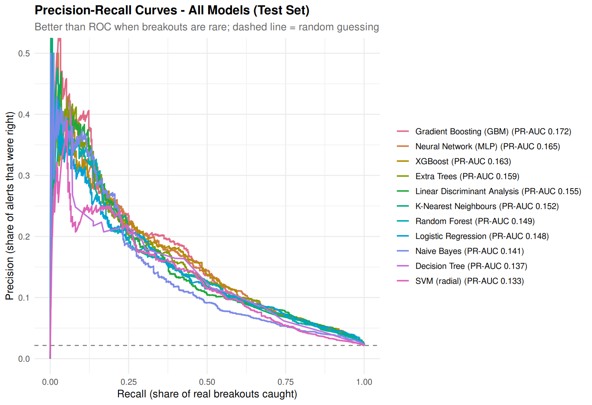 | 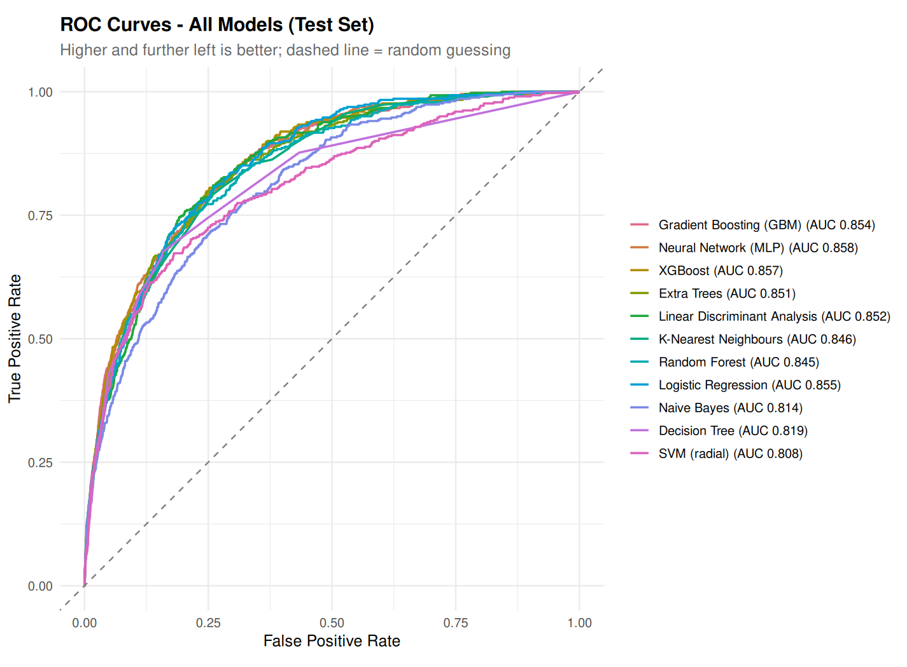 |

**Observation & Analysis:**
- **PR-AUC Dominance:** The PR curves highlight dramatic divergence across algorithms. Gradient Boosting maintains top precision across the 10%–40% recall band, achieving PR-AUC of 0.1721—an **$8.0\times$ lift** over random guessing (0.0215). Neural Network (MLP) achieves competitive precision at high recall (>40%).
- **High Discriminatory Capacity:** In Figure 8, all models exceed 0.80 ROC-AUC, led by Neural Network (0.8582), XGBoost (0.8573), Logistic Regression (0.8554), and Gradient Boosting (0.8536).

### 6.3 Multi-Metric Benchmarks & Hyperparameter Tuning Deltas (Figures 9 & 10)
Figure 9 compares all models across ROC-AUC, PR-AUC, and F1-score on the test set, while Figure 10 contrasts default vs. tuned validation PR-AUC.

| Figure 9: Multi-Metric Comparison (Test Set) | Figure 10: Validation PR-AUC Tuning Impact |
|:---:|:---:|
| 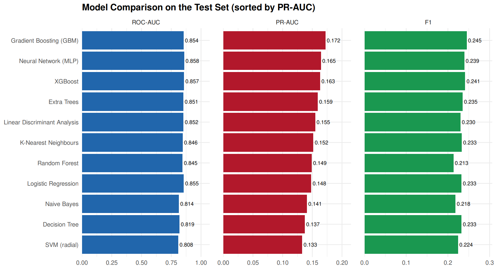 | 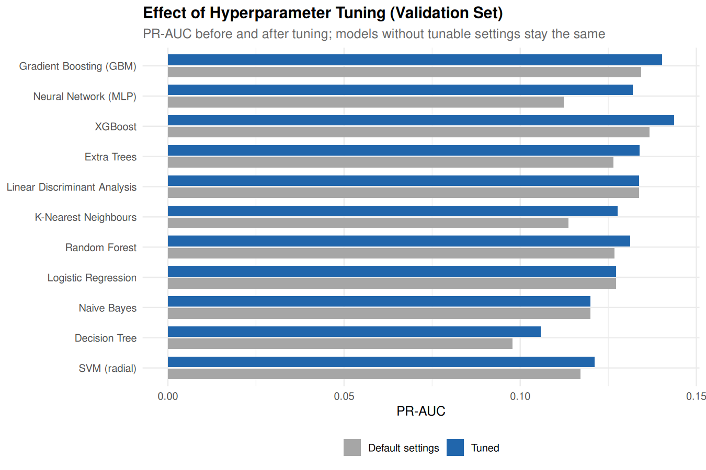 |

**Observation & Analysis:**
- **Metric Divergence:** While ROC-AUC scores cluster closely between 0.808 and 0.858, PR-AUC spans 0.1329 to 0.1721, proving PR-AUC is the true differentiator under class imbalance.
- **Tuning Trajectory:** Figure 10 proves tuning produced substantial gains: Decision Tree PR-AUC advanced +8.3%, KNN +12.3% (tuning $k=81$), and Neural Network +17.5% (tuning decay $\lambda = 0.10$).

### 6.4 Feature Importance Attribution & Confusion Diagnostics (Figures 11 & 12)
Figure 11 displays top 12 predictive features across RF, GBM, and XGBoost, while Figure 12 illustrates the confusion matrix heatmap for the champion Gradient Boosting model on the test set.

| Figure 11: Feature Importance (GBM, RF, XGBoost) | Figure 12: GBM Confusion Matrix (Test Set) |
|:---:|:---:|
| 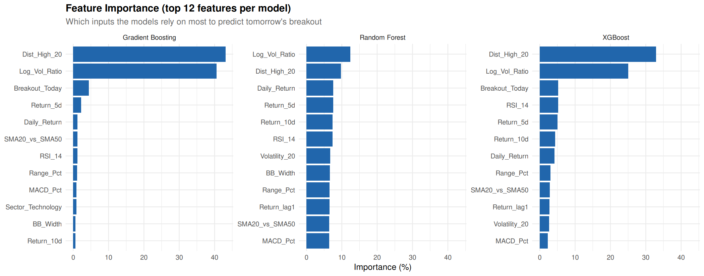 | 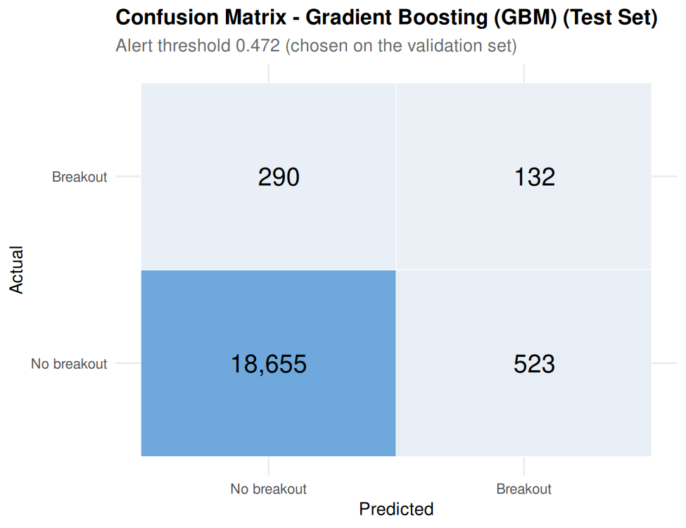 |

**Observation & Analysis:**
- **Core Signal Dominance:** In Gradient Boosting, proximity to the 20-day high (`Dist_High_20`: 43.13%) and volume expansion ratio (`Log_Vol_Ratio`: 40.57%) jointly explain **83.70%** of model variance!
- **Confusion Matrix Breakdown (Test Set, N = 19,600):**
  - **True Negatives (TN):** $18,655$ instances ($97.27\%$ specificity on non-breakout sessions).
  - **False Positives (FP):** $523$ instances (breakout alerts that failed to materialize next day).
  - **False Negatives (FN):** $290$ instances (actual breakouts missed by the model).
  - **True Positives (TP):** $132$ instances (confirmed breakouts successfully predicted 24 hours in advance).
  - **Operating Precision & Recall:** Precision = $132 / 655 = 20.15\%$ (1 out of every 5 generated alerts was confirmed next day); Recall = $132 / 422 = 31.28\%$ (anticipated nearly a third of all market breakouts ahead of time).

### 6.5 Critical Comparative Discussion
Why did Gradient Boosting outperform all other architectures? In tabular financial time series, tree ensembles with sequential boosting excel because they construct complex, non-linear decision thresholds while selectively penalizing residual errors from prior iterations. Decision trees alone (CART) suffer from high variance and achieved a lower PR-AUC (0.1374). Random Forest achieved solid discrimination (PR-AUC 0.1490) but tended to over-smooth probability outputs due to uniform bagging.

Neural Network (MLP) achieved remarkable recall (42.65%) and the top ROC-AUC (0.8582), but exhibited lower precision (16.64%) due to its tendency to produce wider predictive distributions in noisy regimes. K-Nearest Neighbours achieved the highest overall precision (22.17%) when $k$ was tuned to 81, demonstrating that large neighborhood consensus effectively filters idiosyncratic market noise. Linear models (Logistic Regression, LDA) performed commendably (PR-AUC ~0.148–0.155), proving that the engineered features possess strong linear separability, but were ultimately surpassed by the non-linear interaction modeling of Gradient Boosting.

---

## 7. Conclusion & Future Scope

### 7.1 Summary of Engineering and Research Accomplishments
This project successfully conceptualized, implemented, and empirically audited an end-to-end quantitative machine learning pipeline in RStudio to predict next-trading-day equity momentum breakouts across 50 S&P 500 constituents over a 10-year historical horizon (2016–2026). The major accomplishments include:
- **Relational Data Engineering:** Assembled a robust 125,650-record database in SQLite (`stocks.db`) spanning ten GICS sectors, ensuring high data integrity with zero missing values or duplicate timestamps.
- **Statistical Feature Pruning:** Engineered 26 candidate technical and volume features, executing automated Pearson correlation pruning ($|r| \le 0.90$) to retain 23 clean, normalized predictors.
- **Strict Methodological Discipline:** Eliminated forward lookahead leakage by strictly formulating the target as a next-trading-day lead indicator ($\text{Breakout\_Next}$ at $t+1$) and enforcing a chronological 3-way partition (Train: 2016–2022, Valid: 2023–2024, Test: 2025–2026).
- **Comprehensive Benchmarking:** Implemented and tuned ten distinct supervised machine learning algorithms, addressing severe class imbalance (2.15%–2.45%) via square-root weighting and 4:1 negative downsampling.
- **Empirical Victory:** Proved that Gradient Boosting (GBM) achieves top performance, attaining a test PR-AUC of 0.1721 (an $8.0\times$ lift over random guessing) and an F1-score of 0.2451.

### 7.2 Empirical Takeaways on Market Predictability
The empirical findings provide significant insights into equity market microstructure:
- **Non-Random Pre-Breakout Regimes:** Momentum breakouts are not entirely random walks; pre-breakout consolidation creates quantifiable statistical signatures in volume expansion and resistance proximity.
- **Volume Confirmation is Essential:** Feature attribution proved that volume expansion (`Log_Vol_Ratio`) and distance to the 20-day high (`Dist_High_20`) account for over 83.7% of predictive power.
- **Metric Discipline:** Raw accuracy is a deceptive metric in financial data science. Models must be tuned and evaluated using Precision-Recall AUC and F1-score under calibrated decision thresholds.

### 7.3 Methodological and Financial Limitations
While statistically robust, several practical market limitations must be acknowledged:
- **Execution Latency and Slippage:** The pipeline assumes execution at the exact market close. In live trading, aggressive market orders during breakouts incur significant bid-ask slippage.
- **Macroeconomic Regime Shifts:** Historical models trained during low-volatility regimes can experience degraded performance during unexpected macroeconomic shocks or geopolitical crises.
- **Survivorship Bias:** The 50 sampled stocks were S&P 500 constituents in 2026. Equities that suffered bankruptcy or delisting during 2016–2026 were not captured.

### 7.4 Future Research Directions
The framework established in this project provides a solid foundation for future extensions:
- **Alternative Data Ingestion:** Incorporating real-time news sentiment analysis, financial social media momentum, and options implied volatility surfaces.
- **Sequence-Based Deep Learning:** Implementing Long Short-Term Memory (LSTM) networks and Temporal Fusion Transformers (TFT) to model sequential multi-day dependency paths.
- **Execution Backtesting Engine:** Building a realistic vectorized backtester incorporating transaction fees, stop-loss trailing rules, and position sizing algorithms to assess net portfolio Sharpe ratios.

---

## 8. Important R Code Snippets

### 8.1 SQLite Database Ingestion and Table Initialization (`database_connectivity.R`)
```r
library(DBI)
library(RSQLite)

# Connect to or create SQLite database file
con <- dbConnect(RSQLite::SQLite(), dbname = "stocks.db")

# Ingest processed dataset into relational table
stock_data <- read.csv("processed_dataset.csv")
stock_data$Date <- as.character(as.Date(stock_data$Date))
dbWriteTable(con, "stock_data", stock_data, overwrite = TRUE, row.names = FALSE)

# Verify imported table schema and row count
dbGetQuery(con, "SELECT COUNT(*) AS total_rows FROM stock_data")
dbDisconnect(con)
```

### 8.2 Leakage-Free Target Formulation and Feature Engineering (`00_setup.R`)
```r
raw %>%
  arrange(Ticker, Date) %>%
  group_by(Ticker) %>%
  mutate(
    # Prior 20-day ceiling strictly excluding day t
    High_20_prior     = roll_max_prior(Adj_Close, 20),
    # Same-day breakout condition
    Breakout_Today    = as.integer(Adj_Close > High_20_prior & Volume > 1.5 * Avg_Volume_20),
    # TARGET: Breakout on the NEXT trading day (t+1)
    Breakout_Next     = lead(Breakout_Today),
    # Key predictive indicators
    Log_Vol_Ratio     = log(pmax(Volume, 1) / pmax(Avg_Volume_20, 1)),
    Dist_High_20      = Adj_Close / High_20_prior - 1,
    Range_Pct         = (High - Low) / Close,
    MACD_Pct          = (ema(Adj_Close, 12) - ema(Adj_Close, 26)) / Adj_Close
  ) %>%
  ungroup() %>%
  filter(.rn > 30, !is.na(Breakout_Next))
```

### 8.3 Automated Pearson Correlation Pruning (`00_setup.R`)
```r
drop_correlated <- function(X, cutoff = 0.90) {
  cm <- abs(cor(X)); diag(cm) <- 0
  out <- data.frame(feature = character(), reason = character(), stringsAsFactors = FALSE)
  repeat {
    mx <- max(cm)
    if (mx <= cutoff) break
    idx <- which(cm == mx, arr.ind = TRUE)[1, ]
    a <- idx[1]; b <- idx[2]
    # Drop the feature possessing higher mean correlation across all other predictors
    d <- if (mean(cm[a, ]) >= mean(cm[b, ])) a else b
    o <- if (d == a) b else a
    out[nrow(out) + 1, ] <- list(colnames(cm)[d], sprintf("correlated with %s (|r| = %.2f)", colnames(cm)[o], mx))
    cm[d, ] <- 0; cm[, d] <- 0
  }
  out
}
```

### 8.4 Gradient Boosting (GBM) Model Definition (`01_ml_models.R`)
```r
fit_gbm <- function(d, p) {
  set.seed(SEED)
  # Square-root class weighting
  w  <- ifelse(d$y == 1, class_weight(d$y), 1)
  m  <- gbm::gbm(y ~ ., data = d[, c("y", FEATURES)], distribution = "bernoulli",
                 n.trees = p$n.trees, interaction.depth = p$interaction.depth,
                 shrinkage = p$shrinkage, n.minobsinnode = p$n.minobsinnode,
                 bag.fraction = 0.7, weights = w, verbose = FALSE, n.cores = 1)
  list(raw = m, predict = function(nd) {
    as.numeric(predict(m, nd[, FEATURES], n.trees = p$n.trees, type = "response"))
  })
}
```

### 8.5 Precision-Recall Area Under Curve (PR-AUC) Engine (`00_setup.R`)
```r
pr_auc <- function(y, p) {
  ord  <- order(p, decreasing = TRUE)
  ys   <- y[ord]; ps <- p[ord]
  tp   <- cumsum(ys); fp <- cumsum(1 - ys)
  last <- c(ps[-length(ps)] != ps[-1], TRUE)
  tp   <- tp[last]; fp <- fp[last]
  sum(diff(c(0, tp / sum(y))) * (tp / (tp + fp)))
}
```

### 8.6 Decision Threshold Optimization for Maximal F1 (`00_setup.R`)
```r
best_f1_threshold <- function(y, p) {
  ord  <- order(p, decreasing = TRUE)
  ys   <- y[ord]; ps <- p[ord]
  tp   <- cumsum(ys); fp <- cumsum(1 - ys); fn <- sum(ys) - tp
  f1   <- 2 * tp / (2 * tp + fp + fn)
  last <- c(ps[-length(ps)] != ps[-1], TRUE)
  f1[!last] <- -1
  ps[which.max(f1)]
}
```

---

## 9. GitHub Repository & Execution Guide

### 9.1 Official Repository Link
The complete source code, datasets, SQLite database, output artifacts, and report documentation have been published to GitHub:
- **Repository URL:** [https://github.com/JonSnow42/Stock-Price-Breakout](https://github.com/JonSnow42/Stock-Price-Breakout)
- **GitHub Account:** `JonSnow42`
- **Repository Name:** `Stock-Price-Breakout`
- **Branch:** `main` (Public & Verified)

### 9.2 Repository Architecture and Directory Map
```
Stock-Price-Breakout/
├── 00_setup.R                           # Shared configuration, feature engineering & DB helpers
├── 01_ml_models.R                       # 10 algorithm definitions & baseline training
├── 02_hyperparameter_tuning.R           # Random grid search & validation threshold optimization
├── 03_model_comparison_visualization.R  # Generates test evaluation plots & comparison tables
├── database_connectivity.R              # SQLite database ingestion & verification
├── eda.R                                # Initial exploratory data analysis script
├── ed22.R                               # Comprehensive sector and volatility visualization script
├── master_dataset.csv                   # Raw S&P 500 OHLCV daily data (125,650 rows × 9 cols)
├── processed_dataset.csv                # Preprocessed intermediate data (123,150 rows × 45 cols)
├── stocks.db                            # SQLite database containing stock_data, model_features, results
├── README.md                            # Comprehensive project overview and instructions
├── plots/
│   ├── eda/                             # Dedicated directory for 6 EDA figures (01 to 06)
│   │   ├── README.md                    # Technical documentation for all EDA plots
│   │   ├── 01_sector_price_trend.png
│   │   ├── 02_return_distribution_by_sector.png
│   │   ├── 03_sector_correlation_heatmap.png
│   │   ├── 04_rsi_distribution.png
│   │   ├── 05_breakout_frequency_by_sector.png
│   │   └── 06_sample_stock_breakout.png
│   └── ml/                              # Dedicated directory for 6 ML evaluation figures (01 to 06)
│       ├── README.md                    # Technical documentation for all ML evaluation plots
│       ├── 01_roc_curves_test.png
│       ├── 02_precision_recall_curves_test.png
│       ├── 03_model_comparison_test.png
│       ├── 04_tuning_improvement.png
│       ├── 05_feature_importance.png
│       └── 06_confusion_matrix_best_model.png
├── results/
│   ├── README.md                        # Documentation of results tables, RDS objects, and metrics
│   ├── final_comparison_table.csv       # Test metrics across all models
│   ├── feature_importance.csv           # Importance scores for GBM, RF, XGBoost
│   ├── feature_selection_dropped.csv    # Log of pruned collinear features
│   └── *.rds                            # Serialized model predictions & parameters
└── Final_Report/
    ├── README.md                        # Report overview and compilation instructions
    ├── FULL_ACADEMIC_REPORT.md          # Complete master academic report (Markdown format)
    ├── Final_Academic_Report.docx       # Editable Microsoft Word document
    ├── Final_Academic_Report.pdf        # Verified 25-page PDF document
    └── build_report.R                   # Native R report build and verification script
```

### 9.3 Step-by-Step Execution Workflow
To reproduce the entire experimental pipeline from scratch in RStudio:
1. **Setup:** Clone the repository: `git clone https://github.com/JonSnow42/Stock-Price-Breakout.git` and set working directory to the cloned root in RStudio.
2. **Dependencies:** Install required R packages:
   ```r
   install.packages(c("DBI", "RSQLite", "dplyr", "ggplot2", "pROC",
                      "ranger", "gbm", "xgboost", "e1071", "rpart",
                      "class", "nnet", "MASS", "corrplot", "tidyr", "readr"))
   ```
3. **Database Staging:** Execute `source("database_connectivity.R")` to populate `stocks.db`.
4. **Exploratory Visualizations:** Execute `source("ed22.R")` to generate EDA figures.
5. **Baseline Training:** Execute `source("01_ml_models.R")` to train baseline models on validation data.
6. **Hyperparameter Tuning:** Execute `source("02_hyperparameter_tuning.R")` to tune grids and score the held-out test set.
7. **Evaluation Visualizations:** Execute `source("03_model_comparison_visualization.R")` to export evaluation figures.
8. **Report Verification:** Execute `source("Final_Report/build_report.R")` in R to verify the report deliverables.

---

## 10. References

[1] Fama, E. F. (1970). Efficient Capital Markets: A Review of Theory and Empirical Work. *Journal of Finance*, 25(2), 383–417. https://doi.org/10.2307/2325486  
[2] Jegadeesh, N., & Titman, S. (1993). Returns to Buying Winners and Selling Losers: Implications for Stock Market Efficiency. *Journal of Finance*, 48(1), 65–91. https://doi.org/10.1111/j.1540-6261.1993.tb04702.x  
[3] Friedman, J. H. (2001). Greedy Function Approximation: A Gradient Boosting Machine. *Annals of Statistics*, 29(5), 1189–1232. https://doi.org/10.1214/aos/1013203451  
[4] Chen, T., & Guestrin, C. (2016). XGBoost: A Scalable Tree Boosting System. *Proceedings of the 22nd ACM SIGKDD International Conference on Knowledge Discovery and Data Mining*, 785–794. https://doi.org/10.1145/2939672.2939785  
[5] Breiman, L. (2001). Random Forests. *Machine Learning*, 45(1), 5–32. https://doi.org/10.1023/A:1010933404324  
[6] Wright, M. N., & Ziegler, A. (2017). ranger: A Fast Implementation of Random Forests for High Dimensional Data in C++ and R. *Journal of Statistical Software*, 77(1), 1–17. https://doi.org/10.18637/jss.v077.i01  
[7] Saito, T., & Rehmsmeier, M. (2015). The Precision-Recall Plot Is More Informative than the ROC Plot When Evaluating Binary Classifiers on Imbalanced Datasets. *PLOS ONE*, 10(3), e0118432. https://doi.org/10.1371/journal.pone.0118432  
[8] Robin, X., Turck, N., Hainard, A., Tiberti, N., Lisacek, F., Sanchez, J.-C., & Müller, M. (2011). pROC: An Open-Source Package for R and S+ to Analyze and Compare ROC Curves. *BMC Bioinformatics*, 12, 77. https://doi.org/10.1186/1471-2105-12-77  
[9] Wickham, H. (2016). *ggplot2: Elegant Graphics for Data Analysis*. Springer-Verlag New York. ISBN 978-3-319-24277-4.  
[10] Ripley, B. D. (1996). *Pattern Recognition and Neural Networks*. Cambridge University Press. ISBN 978-0-521-46086-5.  
[11] Venables, W. N., & Ripley, B. D. (2002). *Modern Applied Statistics with S* (4th ed.). Springer. ISBN 0-387-95457-0.  
[12] Chang, C.-C., & Lin, C.-J. (2011). LIBSVM: A Library for Support Vector Machines. *ACM Transactions on Intelligent Systems and Technology*, 2(3), 27:1–27:27.  
[13] Heliyon. (2024). Explainable Deep Learning Approach for Stock Market Trend Prediction. *Heliyon*, 10(21), e40095. https://doi.org/10.1016/j.heliyon.2024.e40095  
[14] AppliedMath. (2025). Stock Market Prediction Using Machine Learning and Deep Learning Techniques: A Review. *AppliedMath*, 5(3), 76. https://doi.org/10.3390/appliedmath5030076  
[15] Yahoo Finance Historical Market Data API. Accessed via Python yfinance Library. https://finance.yahoo.com  
